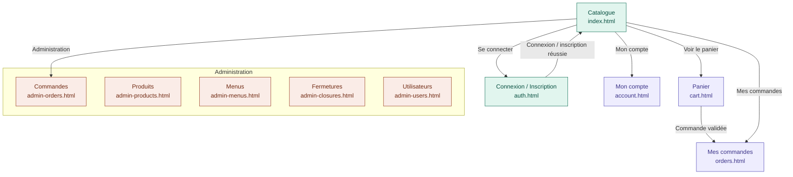

# Conception du front-end — Pol-eat-heck
 
## 1. Les pages
 
| Fichier | Page | Accès | Rôle |
| :--- | :--- | :--- | :--- |
| `index.html` | Catalogue | Tout le monde | Voir les produits et menus, les ajouter au panier |
| `auth.html` | Connexion / Inscription | Visiteur | Se connecter ou créer un compte |
| `cart.html` | Panier | Connecté | Choisir la date de retrait et valider la commande |
| `orders.html` | Mes commandes | Connecté | Voir l'historique de ses commandes |
| `account.html` | Mon compte | Connecté | Voir ses infos, changer son mot de passe |
| `admin-orders.html` | Commandes (admin) | Admin | Voir les commandes du jour, changer leur statut |
| `admin-products.html` | Produits (admin) | Admin | Gérer les produits et les catégories |
| `admin-menus.html` | Menus (admin) | Admin | Gérer les menus et leur composition |
| `admin-closures.html` | Fermetures (admin) | Admin | Gérer les jours de fermeture |
| `admin-users.html` | Utilisateurs (admin) | Admin | Voir les comptes, bloquer / débloquer |

## 2. La navigation
 

Légende : vert = tout le monde, violet = utilisateur connecté, orange = admin.

### La barre de menu selon le profil
 
La barre de menu est présente sur toutes les pages. Son contenu dépend de qui est connecté :
 
| Profil | Liens affichés |
| :--- | :--- |
| Visiteur | Catalogue - Connexion |
| Utilisateur (`standard`) | Catalogue - Panier - Mes commandes - Mon compte - Déconnexion |
| Admin (`admin`) | Les mêmes que l'utilisateur + Produits - Menus - Fermetures - Utilisateurs |